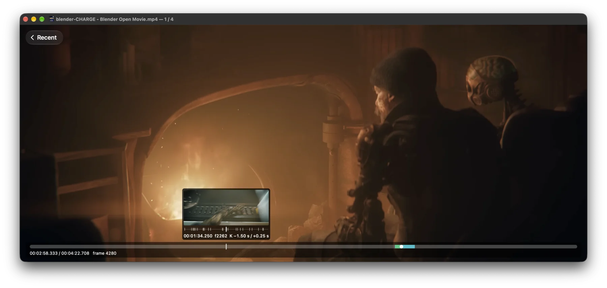
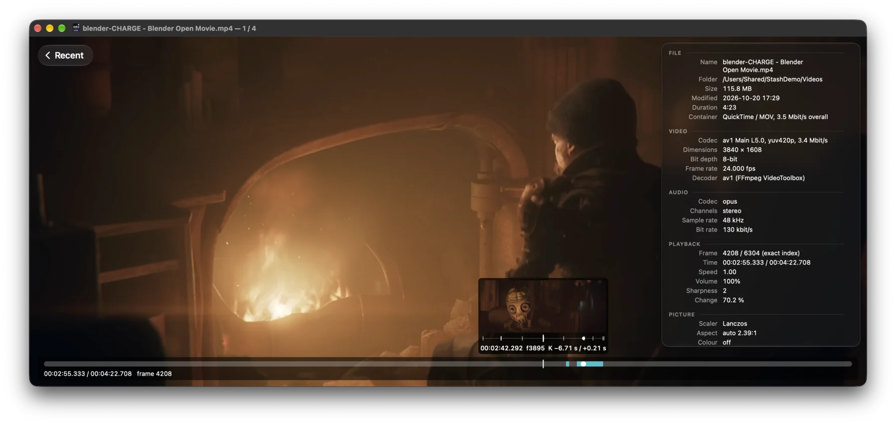
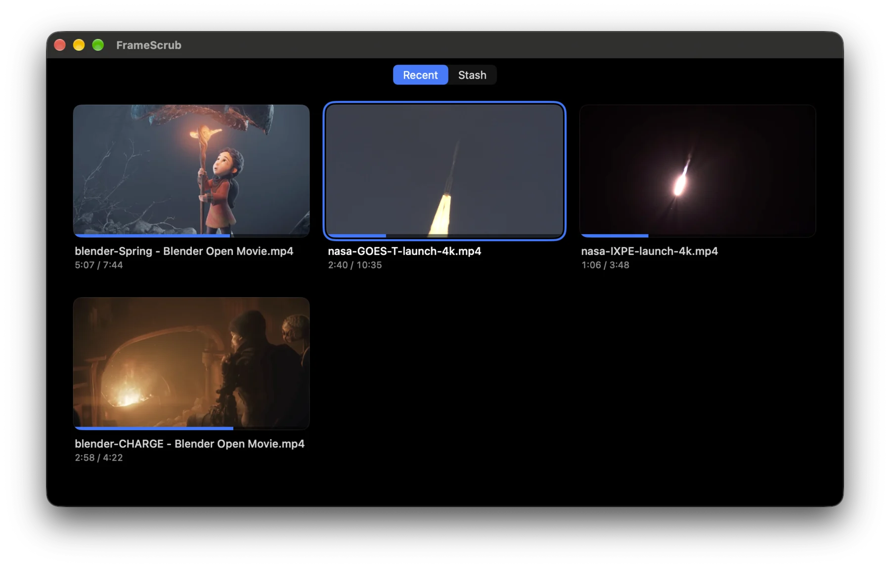
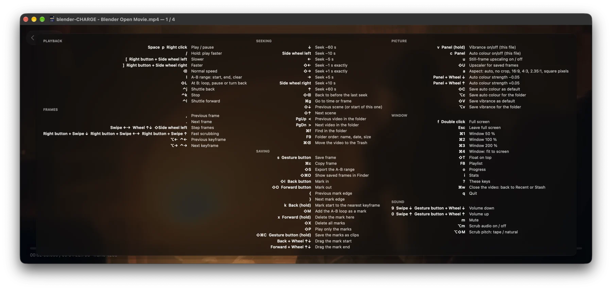
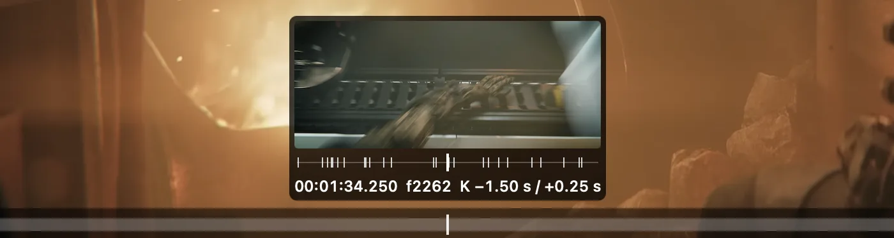
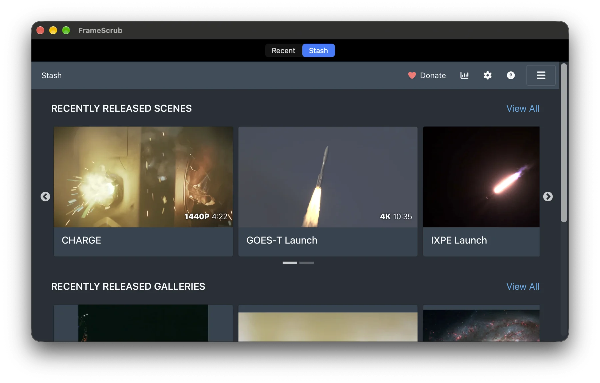

<div align="center">


# FrameScrub

**A frame-accurate video player for macOS. Scrub forward *and backward* through 4K without waiting — and keep the frames you love at full quality.**

For editors, reviewers, animators, photographers pulling stills from video — and anyone who has ever hit ← in a player and watched it freeze.




<sub><i>CHARGE</i> (Blender Studio, CC BY 4.0) in 4K AV1. Hover the seek bar: a preview of that exact frame and a lens of the keyframes around it.</sub>

</div>

---

## Why FrameScrub

- **Backward is as fast as forward.** A cache of decoded frames around the playhead fills in both directions in the background, so stepping back never waits for a keyframe — even in long-GOP 4K HEVC HDR.
- **It plays backward, too.** Real reverse playback at 1, 2, 4 and 8×, frames only, no sound. When the decoder can't keep up, frames are skipped and the speed holds. The A-B loop and Play Marks Only run backward as well.
- **Sound you can scrub, like tape.** Drag through a paused video and hear it the way a reel sounds under your hand: the pitch follows your speed, and scrubbing backward plays the sound in reverse. A single frame step plays a short blip of sound, so you can find a cue, a clap or the first word by ear. Prefer clean audio? `⇧⌥M` keeps the sound's own pitch.
- **Big, bright screens.** HDR (HLG and PQ) through EDR on XDR displays, MetalFX upscaling of 1080p and 4K to 5K and 6K screens, and Apple's neural super-resolution for a paused frame.
- **Its own VideoToolbox pipeline.** Several frames in flight instead of one at a time: ~640 fps for 4K H.264 and ~730 fps for 4K HEVC at ~0.4 ms of CPU per frame.
- **Frames out at full quality.** Save the frame you're on as JPEG, 10-bit HEIC, 16-bit PNG or TIFF in the source colour space (BT.709, HLG, PQ), or export every frame of a range — optionally only the sharpest ones, skipping blurred frames and near-duplicates.
- **Cut without re-encoding.** Mark ins and outs, save them as clips — separately, joined, or everything *except* the marks — snapped to keyframes, losslessly.
- **NAS-friendly.** One shared read cache, MP4 indexes from the header, background index scans for MKV/WebM/TS: seeking over SMB stays quick on high-bitrate files.
- **Your library, your hands.** A start screen with Recent and your [Stash](https://github.com/stashapp/stash) library, mpv-style key bindings, Logitech mouse support with MX Master 4 haptics, a TourBox Lite preset.

## Made for big collections

FrameScrub is built for folders of hundreds of videos on a NAS.

- **It remembers every file.** Each video reopens where you stopped, with its A-B range; the start screen lists Recent videos with how far you got.
- **A folder is a playlist.** `F8` shows it, `⌘F` filters it by name, `F9` sorts it by name, newest or largest, and the next video opens on its own at the end.
- **Cull without leaving the player.** `⌘⌫` moves the video to the Trash and opens the next one (on a share without a Trash it asks first).
- **Shares are first-class.** One read cache per file for every decoder keeps seeks fast over SMB; a share that is asleep or gone gets a clear message, and Return tries again.
- **Black bars are found and cropped** across the whole file, so letterboxed videos fill the window.
- **Your Stash library** as a second start screen, with progress reported back (see [Stash](#stash)).

## Numbers

MacBook Pro, M4 Max, macOS 27. Reproduce with `scripts/measure-startup.sh` and `FRAMESCRUB_PERF=1 swift test --filter PerformanceTests`.

| | |
|---|---|
| **Launch → 4K H.264 frame on screen** | **~430 ms** (window at ~180 ms, first frame decoded at ~290 ms) |
| **4K H.264 decoding, own VideoToolbox session** | **~640 fps**, ~0.4 ms CPU per frame (FFmpeg's VideoToolbox hwaccel: ~150 fps) |
| **4K HEVC decoding** | **~730 fps** |
| **Backward scrubbing at 60 steps/s**, 1080p H.264 and 4K HEVC HLG | **0 misses**, p99 **0.02 ms** per step |
| **Scrubbing a 4K H.264 file with B-frames** | keeps up at **~240 fps** (frames nothing refers to are skipped) |
| **Auto colour + vibrance on a 4K frame** | **~1 ms** of GPU (analysis once per scene) |
| **Simulated NAS, 4K HEVC 30 Mbit/s** | single seeks in **70–160 ms**; holding a key, the picture follows within ~175 ms |

## Features

<table>
<tr>
<td width="50%"></td>
<td width="50%"></td>
</tr>
<tr>
<td><b>Stats panel</b> (<code>i</code>). Container, codec, profile, bit depth, the decoder in use (VideoToolbox, FFmpeg, software), exact frame index, sharpness, scene change, scaler, colour.</td>
<td><b>Start screen.</b> Recent videos with where you stopped and how far you got; resume positions are remembered per file.</td>
</tr>
<tr>
<td colspan="2"></td>
</tr>
<tr>
<td colspan="2"><b>Two keyboard layouts and every key in one sheet</b> (<code>?</code>). <i>Classic</i> is mpv-style; <i>left-hand</i> keeps everything under the left hand while the right one is on the mouse. <code>input.conf</code> applies on top of either.</td>
</tr>
</table>

**Playback and scrubbing**
- Frame stepping both ways, horizontal-scroll scrubbing, Precision Scroll on Logitech mice, scrub audio that plays backward like tape (`⌥M`).
- Shuttle at 1/2/4/8× forward and backward; reverse playback is silent and loops A-B backward too.
- **Keyframe lens** on the seek bar: hover for the keyframes ±20 s around that point and how far the nearest ones are; scroll over the bar to walk the preview from keyframe to keyframe, click to go there.
- Scene detection: jump to the next scene or back to the start of this one.
- `⌘G` goes to a time or frame number; `Shift+Backspace` goes back to before the last seek; a frame step shows the frame type (`K`, `I`, `P`, `B`); hold `/` for 2×.
- A-B loop, cut marks with drag-to-adjust edges and `⌘Z` undo, play only the marked parts.
- H.264 and HEVC (incl. 10-bit HDR) on its own VideoToolbox pipeline; AV1 through FFmpeg, in hardware on M3 and later and with libdav1d otherwise; everything else through FFmpeg too. MP4, MOV, MKV, WebM, TS and more.

<p align="center"></p>

**Picture**
- MetalFX upscaling and HDR tone mapping; Apple's neural super-resolution redraws a paused frame sharper.
- Per-scene auto colour and vibrance, remembered per file and per folder.
- Aspect overrides (16:9, 4:3, 2.35:1, square pixels, …).

**Saving**
- `s` saves the frame; `⇧S` exports an A-B range — every frame, every N-th, N per second, or only the sharpest of every N. The export can skip blurred stretches and frames too like the last one it saved.
- Saved frames can be enlarged ×2, ×4 or to a set size, up to 16384 px; Apple's neural upscaler does it for SDR frames from sources up to 1920 px, Lanczos otherwise.
- `⇧⌘C` saves the marks as clips without re-encoding.

**Hardware**

As far as we know, no other Mac app goes this deep into Logitech hardware, and it keeps growing.

- **Any mouse**: the wheel scrubs, the side wheel seeks, right click plays, and every button and wheel can be rebound in `input.conf`.
- **Logitech mice** on a Bolt or Unifying receiver, over HID++: the gesture button, the haptic panel and Back/Forward get tap, double, long-press and button+wheel bindings; mice with SmartShift can get free spin and Precision Scroll, a frame per wheel event (Settings → Scrolling).
- **MX Master 4 haptics**: patterns you can feel for keyframes, marks, frame steps, the ends of the file, finished saves and errors.
- **TourBox Lite**: a ready-made preset in `extras/tourbox`.

**Icon**
- A Liquid Glass horse that follows macOS's light, dark, clear and tinted icon styles. Prefer your own? Put a PNG or `.icns` in `~/.config/framescrub/icons` and set `app-icon` to its name.

<p align="center"></p>

## Keys

The most useful default (classic) keys. `?` shows every key in effect; **[docs/reference.md](docs/reference.md)** has the full list, the left-hand layout, gestures and settings.

| Keys | Action |
|---|---|
| `Space` | Play / pause |
| `,` `.` | One frame back / forward |
| `⌥←` `⌥→` | Previous / next keyframe |
| `←` `→` / `↓` `↑` | Seek ∓5 s / ∓60 s |
| `Shift+↓` `Shift+↑` | Start of this scene / next scene |
| `Ctrl+j` `Ctrl+k` `Ctrl+l` | Shuttle back / stop / forward (each press faster, up to 8×) |
| Hold `/` | Play at 2× while held |
| `[` `]` `Backspace` | Speed down / up / reset |
| `⌘G` / `Shift+Backspace` | Go to a time or frame / back to before the last seek |
| `l` / `L` | A-B range: start, end, clear / what happens at B |
| `I` `O` / `⌘Z` | Cut mark in / out / undo |
| `s` / `S` / `⇧⌘C` | Save frame / export the A-B range / save the marks as clips |
| `<` `>` | Previous / next video in the folder |
| `f` / `T` | Full screen / float on top |
| `i` / `?` | Stats panel / all keys |

## Stash



FrameScrub plays your **[Stash](https://github.com/stashapp/stash)** library natively. Set the address in Settings → Stash and the start screen gets a **Recent | Stash** switch with the Stash web UI in the window.

- ▶ on a scene opens the file in FrameScrub **straight from its share** — not a transcoded stream — mounting the share if needed (Windows drive letters and `\\server\share` paths are mapped for you).
- Previous/next and autoadvance follow the Stash list you came from: its filter, sort and pages.
- Watched time, resume point and play count go back to Stash exactly as Stash's own player reports them.
- The stats panel gets a Stash section with the scene's details; `⌘⌫` asks Stash to delete a scene and its files.

Stash support keeps growing in FrameScrub and in its sibling image viewer [Loupe](https://github.com/ampire5/Loupe).

## Under the hood

Native Swift and AppKit, with SwiftUI for settings and panels.

| | |
|---|---|
| **Demuxing** | FFmpeg's libavformat, with an index built from the MP4 header or scanned in the background for MKV, WebM and TS, so any frame can be found exactly. |
| **Decoding** | Its own VideoToolbox pipeline: `VTDecompressionSession` with several frames in flight for H.264 and HEVC (8- and 10-bit); FFmpeg's libavcodec for everything else, AV1 included (VideoToolbox hardware decoding on M3 and later, libdav1d otherwise). |
| **Frame cache** | Decoded frames live in IOSurface-backed pixel buffers in a cache around the playhead, which a forward and a backward worker keep filled, so stepping either way is a lookup, not a decode. |
| **Display** | A `CAMetalLayer` with EDR for HDR (HLG and PQ, tone-mapped where the screen can't show it), Core Image for colour, MetalFX upscaling, and VideoToolbox's frame processor for neural super-resolution of paused frames. |
| **Audio** | `AVAudioEngine` with a time-pitch unit for playback at any speed and for tape-style scrub audio (FFmpeg's libswresample converts the samples). |
| **I/O** | One shared read cache per file for every decoder (playback, backward, thumbnails, audio, export), which keeps seeks over SMB fast. |
| **Input** | mpv-style `input.conf`, trackpad and wheel gestures, Logitech mice over IOKit HID with [LogiHIDPP](https://github.com/ampire5/LogiHIDPP). |
| **Structure** | A SwiftPM package with no Xcode project: `FrameScrubCore` (demuxing, decoding, caches, playback, export, with no window code) and the app, on top of the shared packages HomeScreenKit, InfoPanelKit and StashKit. About 20 000 lines of Swift. |
| **Tests** | 1 095 tests in Swift Testing, run against generated fixture videos (exact frame numbers are drawn into every frame), including performance tests for decoding and simulated NAS seeks; CI on GitHub Actions. |

## Install

```sh
brew install --cask ampire5/tap/framescrub
```

Or download the zip from [Releases](https://github.com/ampire5/FrameScrub/releases).

FrameScrub needs macOS 26 or later on Apple Silicon. FFmpeg is built into the app (0.1.0 still needed `brew install ffmpeg`). Intel Macs on macOS 26 get the [`lts/macos26`](https://github.com/ampire5/FrameScrub/tree/lts/macos26) line: the `-lts` releases, which the cask picks on Intel.

**"FrameScrub can't be opened" (zip only).** Builds are not signed with an Apple Developer ID yet. The cask clears the quarantine flag for you; for the zip, try to open the app once, then click **Open Anyway** in System Settings → Privacy & Security, or run:

```sh
xattr -dr com.apple.quarantine /Applications/FrameScrub.app
```

### Edge builds

The latest build that passed CI, not a release: unsigned, for testing. On Apple Silicon these are `main`'s builds, on Intel `lts/macos26`'s. The `framescrub@edge` cask replaces `framescrub` and back; your settings and data stay.

```sh
brew uninstall --cask framescrub                       # the release, if installed: the two casks conflict
brew install --cask ampire5/tap/framescrub@edge
brew update && brew upgrade --cask framescrub@edge     # every new build
brew list --cask --versions framescrub@edge            # the build you have
```

The version says which commit it is: `0.1.0-24-g4410281` is 24 commits after 0.1.0, at commit `4410281`. Back to the
release: `brew uninstall --cask framescrub@edge && brew install --cask ampire5/tap/framescrub`.

**If something goes wrong:**

- **`brew upgrade` finds nothing new.** Homebrew updates the tap only now and then: `brew update` first.
- **`404 Not Found` while downloading.** Only the newest edge zip is kept, so your copy of the tap points at one that is
  gone (or a build is being published right now, which takes a minute): `brew update`, then install or upgrade again.
- **`SHA256 mismatch`.** The same build was published again with a new zip. `brew update`, delete the stale download,
  try again:

  ```sh
  rm -f "$(brew --cache --cask framescrub@edge)"
  brew upgrade --cask framescrub@edge
  ```

- **`Cask 'framescrub' conflicts with 'framescrub@edge'`.** Only one of the two can be installed: uninstall the other first.
- **A half-installed or broken app.** `brew reinstall --cask framescrub@edge`. If Homebrew insists it is installed while the
  app is gone: `brew uninstall --force --cask framescrub@edge`, then install again.
- **The build itself is broken** (crashes, something stopped working). Go back to the release and wait for the next
  build; older edge builds are not kept. Please [report it](https://github.com/ampire5/FrameScrub/issues/new?template=bug_report.yml)
  with the version from `brew list --cask --versions framescrub@edge`.
- **It misbehaves even on the release.** Your settings may be the cause. Quit FrameScrub and move them aside, and it starts
  with the defaults: `mv ~/.config/framescrub ~/.config/framescrub.bak`. To remove all its data, see Uninstall below.

### Build from source

macOS 26 or later on Apple Silicon and the Command Line Tools (`xcode-select --install`). FrameScrub links its own
FFmpeg and dav1d (arm64, static): the first build downloads the prebuilt ones into `.deps/arm64` (`scripts/deps.sh`), or
builds them from source (`scripts/build-deps.sh`, with the tools below) when the recipe has no prebuilt archive yet.

```sh
brew install meson ninja pkgconf
scripts/make-app.sh --install      # → ~/Applications/FrameScrub.app
scripts/test.sh                    # after scripts/make-fixtures.sh (needs Homebrew's ffmpeg tool)
```

A plain `swift build` or `swift run` finds Homebrew's FFmpeg instead, if any: the scripts point SwiftPM at FrameScrub's.

### Uninstall

```sh
brew uninstall --cask framescrub          # the app
brew uninstall --zap --cask framescrub    # also settings, resume positions and thumbnails
```

The data lives in `~/.config/framescrub` (settings, bindings, icons) and `~/Library/Application Support/FrameScrub` (resume positions, folder colours, start-screen pictures); window places are in `~/Library/Preferences/local.framescrub.plist`; `--zap` removes all three. With the zip, delete the app and these by hand.

## Configure

Settings (`⌘,`) has tabs for General, Scrolling, Saving, Display, Mouse & Trackpad and Stash. They edit two plain-text files, keeping your comments:

- `~/.config/framescrub/framescrub.conf` — mpv-style `key=value` settings;
- `~/.config/framescrub/input.conf` — bindings, `<input> <action> [args]`.

See **[docs/reference.md](docs/reference.md)** for every option.

## Privacy

No telemetry, no accounts, no update checks. FrameScrub goes online only to talk to your Stash server, when you set one, and to download Apple's upscaling model once, if you agree. Nothing is written next to your videos except the frames and clips you save.

## Tests

```sh
scripts/make-fixtures.sh                                 # generates Tests/Fixtures (once)
swift test
FRAMESCRUB_PERF=1 swift test --filter PerformanceTests   # also runs the simulated-NAS seeks (makes a 4K file once)
```

## Feedback, bugs and contributing

**I want to hear what you need.** If FrameScrub is close to what you want but not quite there, open a [feature request](https://github.com/ampire5/FrameScrub/issues/new?template=feature_request.yml): what you're trying to do, how you do it today, and what your collection looks like. That is what decides the [roadmap](ROADMAP.md).

Questions, half-formed ideas and stories of how you use it are welcome in [Discussions](https://github.com/ampire5/FrameScrub/discussions).

Bugs go to [Issues](https://github.com/ampire5/FrameScrub/issues/new?template=bug_report.yml). For a bug, please include:

- the macOS version and Mac model;
- the decoder line from the stats panel (`i`; right click → Copy All copies the whole panel);
- the FrameScrub version (for 0.1.0, which used Homebrew's FFmpeg, also `ffmpeg -version`);
- whether the file plays in QuickTime Player.

Pull requests are welcome; a full contributing guide is on the roadmap.

## Roadmap

Next up: subtitles and audio tracks, the shared Settings and Home from Loupe, a filmstrip in the seek bar — and a plugin architecture for media servers (Plex, Jellyfin, DLNA, HLS). See **[ROADMAP.md](ROADMAP.md)**.

## Credits

Screenshots show *CHARGE* and *Spring* by Blender Studio (CC BY 4.0) and launch footage by NASA (public domain).

## License

GPL-3.0-or-later (see [LICENSE](LICENSE)). FrameScrub uses [FFmpeg](https://ffmpeg.org) (LGPL/GPL), the MIT-licensed packages [HomeScreenKit](https://github.com/ampire5/HomeScreenKit), [InfoPanelKit](https://github.com/ampire5/InfoPanelKit) and [StashKit](https://github.com/ampire5/StashKit), and [LogiHIDPP](https://github.com/ampire5/LogiHIDPP) (GPL-3.0).
